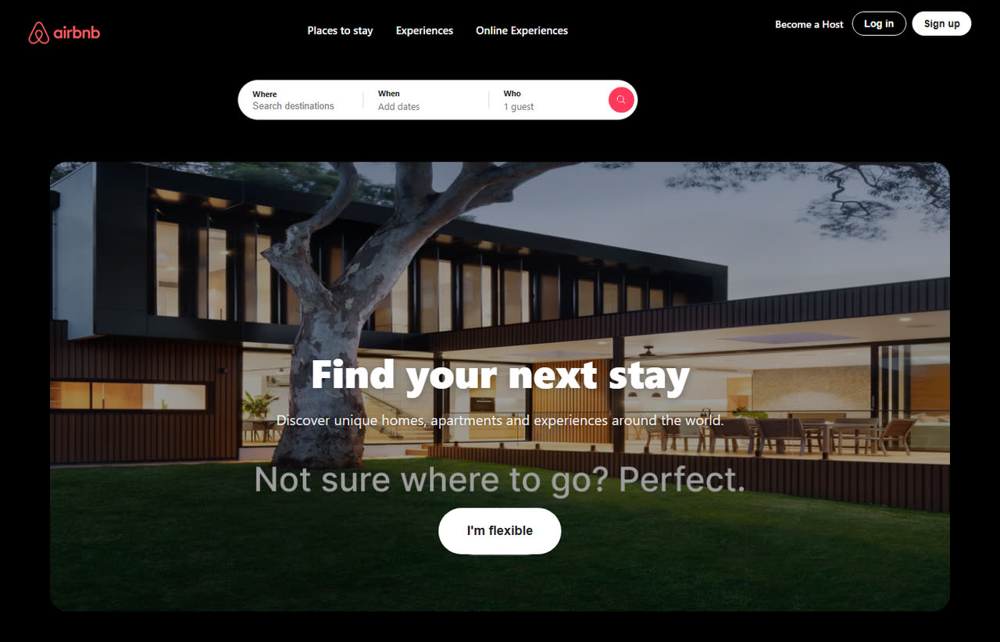
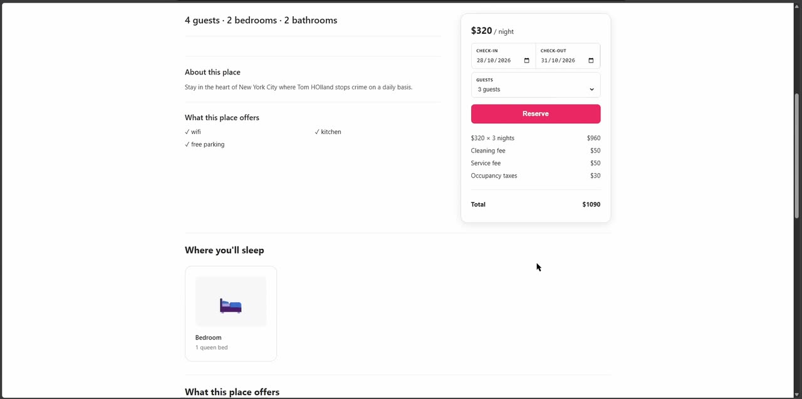
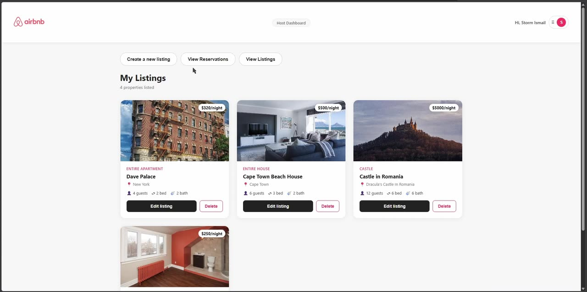

# Airbnb Clone (Capstone)

This is my capstone project for the Zaio Full Stack Web Development bootcamp. The idea: rebuild the core of Airbnb from scratch, front to back. Guests can search for a place, pick their dates and book it, and hosts can sign in to put up their own listings and see who's booked them.

**Live:** https://airbnb-frontend-9obn.onrender.com

It's on Render's free plan, so if nobody's used it in a while the listings can take up to a minute to show up while the server wakes up. After that it's quick.



## What it does

**As a guest**
- Search for places by location (the search bar only suggests locations that actually have listings)
- Open a listing to see the photos, what the place offers, reviews and who the host is
- Pick your dates and book. The price gets worked out as you go: nightly rate × nights, plus the cleaning fee, service fee and taxes, and a weekly discount if you stay 7 nights or more
- See and cancel your bookings under My Reservations

**As a host**
- Sign in through "Become a Host"
- Create, edit and delete your own listings, with photos uploaded straight to Cloudinary
- See every reservation made on your listings





## Tech

- **Frontend:** React (Vite) + React Router
- **Backend:** Node.js + Express, a REST API
- **Database:** MongoDB Atlas with Mongoose
- **Auth:** JWT tokens, passwords hashed with bcrypt, and roles (guest, host, admin)
- **Images:** Cloudinary
- **Hosting:** Render (the frontend as a static site, the backend as a web service)

## What's in here

```
airbnb-capstone/
├── backend/                     the Express API
│   ├── server.js                starts the server, connects to MongoDB, registers the routes
│   ├── models/                  User, Accommodation, Reservation
│   ├── controllers/             the actual logic behind each route
│   ├── routes/                  users, accommodations, reservations
│   └── middleware/auth.js       checks the JWT token and the user's role
├── frontend/                    the React app (guests and hosts both use this one)
│   └── src/
│       ├── pages/               home, search, listing, login/register, my reservations
│       ├── pages/host/          the host side: listings, create/edit listing, reservations
│       ├── components/          header, footer, confirm popup
│       └── utils/cloudinary.js  uploads listing photos to Cloudinary
├── admin-dashboard/             the old separate host app (merged into frontend, kept for reference)
└── docs/screenshots/            the images in this README
```

## Running it yourself

### Backend

```bash
cd backend
npm install
```

Create a `.env` file in `backend/`:

```
PORT=5000
MONGO_HOST=your-atlas-shard-hostnames
MONGO_USER=your-database-user
MONGO_PASS=your-database-password
JWT_SECRET=any-long-random-string
```

`MONGO_HOST` is the list of shard hostnames from your Atlas cluster, not the usual `mongodb+srv://` string (more on why below). The replica set name in `server.js` also needs to match your cluster.

```bash
npm run dev
```

### Frontend

```bash
cd frontend
npm install
```

Create a `.env` file in `frontend/` pointing at the backend:

```
VITE_API_URL=http://localhost:5000
```

```bash
npm run dev
```

Photo uploads go to my Cloudinary account, so if you want to use your own, swap the cloud name and upload preset in `frontend/src/utils/cloudinary.js`.

## The API

| Method | Route | Who can use it |
| --- | --- | --- |
| POST | `/api/users/register` | anyone (signs up as a guest or a host) |
| POST | `/api/users/login` | anyone |
| GET | `/api/accommodations` | anyone |
| GET | `/api/accommodations/:id` | anyone |
| POST | `/api/accommodations` | hosts |
| PUT | `/api/accommodations/:id` | the host who owns the listing |
| DELETE | `/api/accommodations/:id` | the host who owns the listing |
| POST | `/api/reservations` | logged-in guests |
| GET | `/api/reservations/user` | the guest's own bookings |
| GET | `/api/reservations/host` | bookings on the host's listings |
| DELETE | `/api/reservations/:id` | the guest who booked it, or the host |

Admins can do everything a host can, on any listing.

## Challenges I ran into (and how I fixed them)

**Images kept breaking.** The listing photos kept failing to load. I changed the way they were stored, which helped, but some still weren't showing up. So I moved all the photo uploads to Cloudinary. Now the browser uploads the photo straight to Cloudinary and the listing just saves the link, so the images don't depend on my server at all.

**Two separate apps.** I first built the host side as its own separate React app (that's the `admin-dashboard/` folder). When I showed the project for marking, the feedback was that it should all be one link that launches together: "Become a Host" should take you to the host sign-in, and a normal sign-up should just be for viewing and cancelling your bookings. So I merged everything into one frontend with two different ways of signing in.

**Security holes I found once it was working.** When I went back over the API, I found some big ones. Any logged-in user could edit or delete anyone else's listing, and you could make yourself an admin just by sending `role: "admin"` when you signed up. I added ownership checks (only the host who owns a listing, or an admin, can change it), locked sign-up to guest or host only (admins have to be set manually in the database), and added a role check so only hosts can create listings.

**MongoDB Atlas wouldn't connect.** The normal `mongodb+srv://` connection string kept failing because of a DNS issue with SRV records. Connecting with the direct shard hostnames instead fixed it, which is why the `.env` looks a bit different from most MongoDB setups.

**Everything pointed at localhost.** All the API calls were hardcoded to `localhost:5000` at first, which broke as soon as I deployed it. I moved the address into an environment variable (`VITE_API_URL`) so the same code works on my machine and on Render.

## What I'd improve next

- **Stop double bookings.** Right now nothing stops two guests booking the same dates. The backend should check for overlapping reservations before saving a new one.
- **Work out the price on the server.** The total is calculated in the browser and sent to the API, so the server should recalculate it rather than trust what it's sent.
- **Payments**, and an availability calendar on each listing so guests can see which dates are taken.
